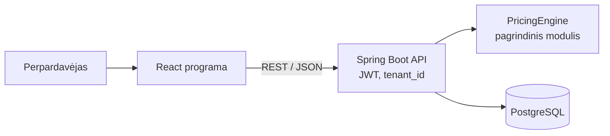

# PartijaPro: partijų savikaina ir kainodara

Kursinio darbo I dalis: projektavimo dokumentas

## 1. Problema ir idėja

**Sistema vienu sakiniu:** Sistema drabužių perpardavėjams (Vinted ir pan.), kuri nupirktos prekių partijos kainą paskirsto kiekvienai prekei, pasiūlo pardavimo kainas ir parodo, ar partija atsipirko.

**Problema ir dabartinis procesas:** Perpardavėjai perka prekes partijomis (outlet dėžės, urmas) už vieną bendrą kainą. Dabar savikaina skaičiuojama skaičiuoklėje: partijos kaina dalijama iš prekių skaičiaus po lygiai, nors striukės ir marškinėlių vertė skiriasi kelis kartus. Kainos ir nuolaidos nustatomos „iš akies“, todėl dalis prekių parduodama žemiau savikainos, o partijos pelnas paaiškėja tik viską išpardavus.

**Nauda:** Kiekviena prekė gauna pagrįstą savikainą, kainos skaičiuojamos pagal vienodas taisykles, nuolaida niekada nenuleidžia kainos žemiau minimalios, o partijos pelnas matomas bet kuriuo metu.

**Naudotojai:** Perpardavėjas (savininkas). Sukuria partiją, įveda prekes, gauna savikainas ir kainas, žymi pardavimus, mato partijos pelną. Padėjėjas gali įvesti prekes ir žymėti pardavimus, bet negali keisti kainodaros nustatymų.

**Prielaidos:**
- Partija perkama už vieną kainą, o prekių skaičius ir būklė paaiškėja išpakavus (žinoma iš mano patirties).
- Kiekvienas perpardavėjas pats nustato antkainius ir kategorijų koeficientus.
- Kategorijos ir būklės koeficientai pakankamai gerai atspindi santykinę prekių vertę.
- Duomenys įvedami ranka arba CSV failu, nes Vinted neturi viešo API skelbimams valdyti.

## 2. Apimtis

| Funkcija | Ką naudotojas galės atlikti | Pagrindinis modulis ar pagalbinė funkcija |
|---|---|---|
| Savikainos paskirstymas ir kainos | Paspausti „Apskaičiuoti“ ir gauti kiekvienos prekės savikainą, rekomenduojamą ir minimalią kainą | Pagrindinis modulis |
| Kainos mažinimo grafikas | Matyti sąrašą „šiandien perkainoti“: kurias prekes ir iki kokios kainos atpiginti | Pagrindinis modulis |
| Partijos įvedimas | Įvesti partijos kainą, išlaidas ir prekes (forma arba CSV) | Pagalbinė |
| Pardavimai ir partijos pelnas | Pažymėti prekę parduota ir matyti partijos pelną bei atsipirkimą | Pagalbinė |
| Organizacija ir nustatymai | Sukurti savo organizaciją, pakviesti padėjėją, nustatyti antkainius ir koeficientus | Pagalbinė |

**Į kursinio darbo apimtį neįeina:** automatinis skelbimų kėlimas ir duomenų rinkimas iš Vinted, automatinis rinkos kainų nustatymas, mokėjimai, buhalterinė apskaita ir VMI ataskaitos, mobilioji programėlė.

## 3. Pagrindinis modulis

**Pavadinimas ir atsakomybė:** „Partijos kainodara“ (`PricingEngine`). Paskirsto partijos savikainą prekėms, apskaičiuoja rekomenduojamą ir minimalią kainą ir sudaro kainos mažinimo grafiką.

**Logika, kurią reikės projektuoti ir testuoti:** savikainos paskirstymas pagal svorius kartu su ranka įvestomis savikainomis, apvalinimas be dingstančių centų, kainos skaičiavimas su antkainiu ir kanalo mokesčiu, kainos mažinimas su apatine riba.

**Įvestis:** partijos kaina ir išlaidos, prekės (kategorija, būklė, nebūtina rankinė savikaina, nebūtina rinkos kaina, skelbimo data) ir naudotojo nustatymai. Pavyzdys: pirkimas 180 €, pristatymas 20 €; striukė (savikaina įvesta ranka 50 €), 3 džinsai, 9 marškinėliai.

**Išvestis:** kiekvienos prekės savikaina, rekomenduojama ir minimali kaina, perspėjimai. Pavyzdys: džinsai – savikaina 20,00 €, kaina 40 €, minimali 24 €.

**Veikimo eiga:**
1. Naudotojas įveda partiją ir prekes.
2. Sistema patikrina duomenis ir apskaičiuoja visą savikainą S.
3. Pritaiko taisykles R1–R5.
4. Rezultatas išsaugomas, prekės rodomos su kainomis ir sąraše „šiandien perkainoti“.

### Taisyklės arba sprendimo žingsniai

1. **R1, savikainos paskirstymas.** `S = pirkimas + pristatymas + kitos išlaidos`. Ranka įvestos savikainos (jų suma M) nekeičiamos, o likutis `S − M` dalijamas likusioms prekėms pagal svorį `w = kategorijos koef. · būklės koef.` (pvz., striukė 3, džinsai 2, marškinėliai 1; būklė „labai gera“ 1,0). Jei `M > S`, grąžinama klaida.
2. **R2, apvalinimas.** Kiekviena dalis apvalinama žemyn iki cento, o likę centai po 1 ct atiduodami prekėms su didžiausia nukirsta dalimi (jei lygios – pirmai prekei). Savikainų suma visada lygi `S`.
3. **R3, kainos.** `kaina = savikaina · (1 + antkainis) / (1 − kanalo mokestis)`, apvalinama aukštyn iki euro. Rekomenduojamai kainai naudojamas tikslinis antkainis (numatyta 100 %), minimaliai – minimalus (numatyta 20 %). Kanalo mokestis nustatomas (Vinted pardavėjui 0 %).
4. **R4, kainos mažinimas.** Kas 14 dienų neparduota prekė pigsta 10 % nuo dabartinės kainos (apvalinama žemyn iki euro), bet ne žemiau minimalios. Pasiekus minimalią kainą, prekė pažymima „reikia peržiūrėti“.
5. **R5, rinkos kaina.** Jei įvesta rinkos kaina mažesnė už rekomenduojamą, kaina sumažinama iki jos, bet ne žemiau minimalios. Jei rinkos kaina mažesnė už minimalią, prekė pažymima „nuostolinga rizika“.

### Scenarijai būsimiems testams

| Scenarijus | Pradinės sąlygos ir konkreti įvestis | Veiksmas | Tikslus laukiamas rezultatas |
|---|---|---|---|
| Įprastas atvejis | S = 200 €; striukė ranka 50 €, 3 džinsai (w = 2), 9 marškinėliai (w = 1) | Apskaičiuoti partiją | Džinsai po 20,00 €, marškinėliai po 10,00 €. Džinsų kaina 40 €, minimali 24 €. Suma 200,00 € |
| Ribinis: apvalinimas | S = 100 €, 3 vienodo svorio prekės | Apskaičiuoti partiją | 33,34 €, 33,33 €, 33,33 €. Suma lygiai 100,00 € |
| Ribinis: minimali kaina | Džinsai: kaina 40 €, minimali 24 €, neparduoti 70 dienų | Sudaryti mažinimo grafiką | 36 → 32 → 28 → 25 → 24 € (ne 22 €), žyma „reikia peržiūrėti“ |
| Konfliktas: rinkos kaina | Marškinėliai: savikaina 10 €, minimali 12 €, rinkos kaina 9 € | Apskaičiuoti kainą | Kaina 12 €, žyma „nuostolinga rizika“ |
| Klaida: per didelės rankinės savikainos | S = 200 €, ranka įvesta 120 € ir 90 € (M = 210 €) | Apskaičiuoti partiją | Klaida „Rankinės savikainos (210,00 €) viršija partijos savikainą (200,00 €)“, niekas neišsaugoma |

**Jei modulis naudoja AI:** Netaikoma. Savikainos ir kainos turi būti tikslios ir pasikartojančios, todėl logika deterministinė.

## 4. Kokybės atributas

**Pasirinktas atributas:** keičiamumas (naują kainodaros taisyklę galima pridėti nekeičiant esamų).

**Kodėl svarbus šiai sistemai:** Perpardavėjai skaičiuoja skirtingai: vieni skirsto savikainą pagal kategorijas, kiti pagal rinkos kainą ar svorį kilogramais; vieni pigina kas savaitę, kiti sezoniškai. Naujos taisyklės neturi gadinti jau veikiančių.

**Tikrinimo scenarijus ir sąlygos:** 3 etape pridedu dvi naujas taisykles: savikainos paskirstymą „pagal rinkos kainą“ ir „sezoninį“ kainos mažinimą (pvz., žieminės prekės pavasarį −20 %).

**Sėkmės kriterijus:** Naujos taisyklės yra naujos klasės. Esamose taisyklių klasėse ir `PricingEngine` pakeista 0 eilučių (pagal `git diff`). Visi ankstesni testai praeina nepakeisti, o naujoms taisyklėms parašyta bent po 3 testus.

**Numatytas projektavimo sprendimas:** Strategy šablonas: sąsajos `CostAllocationStrategy` ir `MarkdownPolicy`, o `PricingEngine` priklauso tik nuo jų. Konkreti strategija parenkama pagal naudotojo nustatymus. Pagrindinis modulis nepriklauso nuo duomenų bazės, todėl testuojamas atskirai.

**Kaip patikrinsiu vėlesniame etape:** Pakeitimą darysiu atskirame commit'e ir parodysiu `git diff --stat` bei testų rezultatus prieš ir po pakeitimo.

**Sprendimo kaina arba ribojimas:** Daugiau sąsajų ir klasių, todėl iš pradžių kodas sudėtingesnis. Tai pateisinama, nes dvi paskirstymo strategijos (pagal svorį ir ranka) reikalingos jau prototipe.

## 5. Pradinė sistemos struktūra

### Paprasta schema

| Sistemos dalis | Atsakomybė |
|---|---|
| React programa | Partijos įvedimo forma ir CSV, kainų lentelė, sąrašas „šiandien perkainoti“, partijos pelnas |
| Spring Boot API | Prisijungimas, rolės, užklausų apdorojimas; kiekviena užklausa mato tik savo organizacijos duomenis |
| PricingEngine | Taisyklės R1–R5, be priklausomybių nuo duomenų bazės |
| PostgreSQL | Organizacijos, naudotojai, partijos, prekės, pardavimai ir nustatymai; visose lentelėse yra `tenant_id` |

**Planuojamos technologijos ir pasirinkimo priežastys:** Java 21 ir Spring Boot (kurse naudojama Java, gera DI ir testų palaikymas su JUnit ir Mockito), `BigDecimal` pinigams, kad nebūtų apvalinimo klaidų, PostgreSQL, React su TypeScript, Docker Compose, kad visa sistema pasileistų viena komanda.

## 6. AI panaudojimas

### AI rengiant šį dokumentą

| Priemonė ir užduotis | Ką panaudojau | Ką atmečiau arba perrašiau ir kodėl | Kaip patikrinau |
|---|---|---|---|
| Claude: perskaitė užduoties aprašą, šabloną ir paskaitų skaidres, pagal mano idėją parašė juodraštį | Struktūrą, taisyklių ir scenarijų formuluotes | Idėją ir verslo kontekstą pateikiau pats. Atsisakiau automatinio kainų rinkimo iš Vinted ir antro kokybės atributo, kad apimtis būtų realistiška | Pavyzdžius perskaičiavau ranka, sutikrinau su užduoties aprašu |

### Planuojamas AI naudojimas kuriant sistemą

**Kur ir kam naudosiu AI:** kodo ir testų juodraščiams, klaidų paieškai, refaktorinimo pasiūlymams.

**Kaip tikrinsiu pasiūlymus ir sugeneruotą kodą:** skaitau kiekvieną pakeitimą, paleidžiu testus, taisyklių pavyzdžius skaičiuoju ranka. Laukiamų testų reikšmių AI nekeičia.

**Rizikos:** AI gali pasiūlyti klaidingą kodą, ypač apvalinant pinigus ar filtruojant duomenis pagal organizaciją. Todėl nepriimu kodo, kurio negaliu paaiškinti, ir kiekvieną pakeitimą tikrinu testais.

**Ar AI bus sistemos funkcionalumo dalis:** Ne.

## 7. Tolesnių darbų planas

| Darbas | Apčiuopiamas rezultatas | Planuojama darbų seka |
|---|---|---|
| Projekto paruošimas | Repozitorija, Docker Compose, README su paleidimo komanda | 1 |
| PricingEngine ir testai | R1–R5 veikia, visi 3 skyriaus scenarijai yra žali testai | 2 |
| API ir duomenų bazė | Partiją galima išsaugoti ir apskaičiuoti; kiekvienas mato tik savo duomenis | 3 |
| Naudotojo sąsaja | Partijos įvedimas, kainų lentelė, sąrašas „šiandien perkainoti“ | 4 |
| Pardavimai ir pelnas | Pardavimų žymėjimas ir partijos pelnas | 5 |

**Būsimo prototipo veikimo scenarijus:** Įvedu partiją: 180 € + 20 €, striukė (ranka 50 €), 3 džinsai, 9 marškinėliai. Tikiuosi savikainų 50 / 20 / 10 €, kainų 100 / 40 / 20 € ir minimalių kainų 60 / 24 / 12 €. Nustačius džinsų skelbimo datą prieš 28 dienas, jie turi atsirasti sąraše „šiandien perkainoti“ su kaina 32 €.

| Rizika arba neaiškumas | Kaip patikrinsiu arba sumažinsiu |
|---|---|
| Koeficientai blogai atspindi realią prekių vertę | Patikrinsiu su 2–3 savo realiomis partijomis; savikainą visada galima įvesti ranka |
| Pinigų apvalinimo klaidos | `BigDecimal`, testas, kad savikainų suma visada lygi `S` |
| Duomenų atskyrimas tarp organizacijų | Testas, kad vienos organizacijos naudotojas negauna kitos duomenų |

## Šaltiniai, jei naudojote

- Programų sistemų projektavimo paskaitų medžiaga (SOLID, testavimas, projektavimo šablonai).
- Gamma E. ir kt. *Design Patterns* (1995) – Strategy šablonas.
- Idėja grįsta mano patirtimi perparduodant drabužius.

AI naudojimas aprašytas 6 skyriuje.
